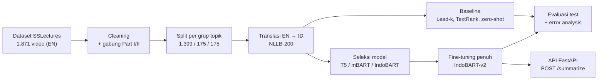

# Peringkasan Otomatis Transkrip Video Kuliah Berbahasa Indonesia

> Peringkasan **abstraktif** transkrip video kuliah berbahasa Indonesia dengan **fine-tuning model Transformer seq2seq (IndoBART-v2)**. Model berjalan mandiri tanpa layanan AI pihak ketiga, dan nantinya dilayani lewat REST API FastAPI.


Tugas 2 Mata Kuliah **Deep Learning**, Program Studi Teknologi Informasi, Universitas Udayana.

**Kelompok 6**
- I Made Ray Adhya Khrisna
- Ida Bagus Komang Adi Prayista
- Nolan Mahotama Abipantara Urya Gotama

---

## Daftar Isi

- [Ringkasan Proyek](#ringkasan-proyek)
- [Status Progres](#status-progres)
- [Dataset](#dataset)
- [Alur Pipeline](#alur-pipeline)
- [Hasil](#hasil)
- [Struktur Repository](#struktur-repository)
- [Cara Menjalankan](#cara-menjalankan)
- [Menjalankan API](#menjalankan-api)
- [Catatan Teknis](#catatan-teknis)
- [Keterbatasan](#keterbatasan)
- [Rencana Berikutnya](#rencana-berikutnya)

---

## Ringkasan Proyek

| | |
|---|---|
| **Masalah** | Transkrip kuliah panjang (median ±1.000 kata) dan bergaya lisan, sehingga sulit dibaca ulang dengan cepat |
| **Pendekatan** | Fine-tuning model seq2seq berbahasa Indonesia untuk menghasilkan ringkasan bergaya tulisan formal |
| **Model utama** | [`indobenchmark/indobart-v2`](https://huggingface.co/indobenchmark/indobart-v2) (132 juta parameter) |
| **Evaluasi** | ROUGE-1 / ROUGE-2 / ROUGE-L (F1), dibandingkan dengan 3 baseline |
| **Input panjang** | Truncation vs chunk-and-summarize |
| **Deployment** | FastAPI `POST /summarize`, diuji dengan Postman |

**Hasil akhir (set test, 175 video):** model final (truncation) mencapai **ROUGE-1 43,67 / ROUGE-2 16,89 / ROUGE-L 24,64**, mengalahkan baseline terkuat Lead-7 (37,66 / 13,52 / 21,79) di ketiga metrik, dengan panjang ringkasan ±130 kata (referensi ±124 kata).

---

## Status Progres

| Tahap | Isi | Status |
|:---:|---|:---:|
| 1 | Profiling dataset + uji 3 model translasi EN → ID | ✅ |
| 2 | Cleaning, penggabungan Part I/II, split 80/10/10 per grup topik | ✅ |
| 3 | Translasi penuh EN → ID (NLLB-200) + kontrol kualitas | ✅ |
| 4 | Evaluasi ROUGE + 3 baseline + truncation vs chunk-and-summarize | ✅ |
| 5 | Seleksi model utama (T5-base few-shot, mBART-50, IndoBART-v2) | ✅ → **IndoBART-v2** |
| 6 | Fine-tuning penuh IndoBART-v2 (4 konfigurasi + pengaturan panjang ringkasan) | ✅ |
| 7 | Evaluasi akhir di set test + error analysis | ✅ |
| 8 | REST API FastAPI (`POST /summarize`) + uji Postman | ✅ |
| 9 | Laporan, slide, dan rilis bobot model | ⏳ Rencana |

---

## Dataset

- **Sumber:** `ak_lectures_summarized.csv`, subset AK Lectures dari dataset **SSLectures** (pasangan transkrip kuliah dan ringkasannya dalam bahasa Inggris).
- **Isi:** 1.871 video dari 6 mata kuliah (Classical physics, Organic chemistry, Biochemistry, Biology, Modern physics, General chemistry).
- **Setelah cleaning:** 1.749 pasangan, dibagi menjadi **train 1.399 / val 175 / test 175**.
- Data **tidak disertakan** di repo (lihat `.gitignore`). Letakkan file CSV di Google Drive sesuai bagian [Cara Menjalankan](#cara-menjalankan).

| Statistik (setelah translasi) | Nilai |
|---|---|
| Median panjang transkrip | 1.458 token |
| Transkrip lebih panjang dari 512 token | **99%** |
| Median panjang ringkasan | 189 token (±121 kata) |
| Ringkasan yang muat dalam 512 token | 97,7% |

Karena hampir semua transkrip melebihi 512 token, strategi input panjang (truncation vs chunk-and-summarize) menjadi salah satu fokus evaluasi.

---

## Alur Pipeline



### Cleaning data

```
1.871 data awal
  → 1.842  buang transkrip / ringkasan kosong
  → 1.802  gabung Part I + Part II yang ringkasannya sama (39 baris gabungan)
  → 1.759  buang anomali (ringkasan < 20 kata / lebih panjang dari transkrip)
  → 1.749  buang ringkasan kembar beda topik
  → split per grup topik (GroupShuffleSplit, seed 42), irisan antar split = 0
```

Split dilakukan **per grup topik** supaya Part I dan Part II dari video yang sama tidak terpisah ke train dan test (mencegah kebocoran data).

### Translasi EN → ID

Tiga model translasi diuji pada 60 sampel yang sama. **NLLB-200 (distilled 600M)** dipilih karena satu-satunya yang bersih di ketiga indikator:

| Model | Artefak spasi | Kata Melayu | Sisa kata Inggris |
|---|:---:|:---:|:---:|
| opus-mt-en-id | 37 | 0 | 6 |
| m2m100_418M | 4 | 16 | 1 |
| **nllb-200-distilled-600M** | **4** | **0** | **1** |

Kontrol kualitas translasi penuh: 0 baris gagal, sisa kata Inggris 0,02 per transkrip, 1 kasus halusinasi (repetition loop) diterjemahkan ulang, dan 3 istilah dikoreksi (*ceramah → kuliah*, *lapisan kuman → lapisan germinal*, *konstan gravitasi → konstanta gravitasi*).

---

## Hasil

Semua skor adalah **ROUGE F1** dengan stemmer dimatikan, karena stemmer bawaan library hanya untuk bahasa Inggris.

### 1. Baseline (set test, 175 video)

| Metode | ROUGE-1 | ROUGE-2 | ROUGE-L | Panjang |
|---|:---:|:---:|:---:|:---:|
| **Lead-7** | **37,66** | **13,52** | **21,79** | 127 kata |
| TextRank-5 | 34,65 | 10,58 | 19,32 | 171 kata |
| Zero-shot T5 (truncation) | 27,60 | 9,94 | 18,07 | 45 kata |
| Zero-shot T5 (chunk-and-summarize) | 28,31 | 9,94 | 18,21 | 49 kata |

- Nilai k untuk Lead-k dan TextRank dipilih di set val.
- Zero-shot memakai `cahya/t5-base-indonesian-summarization-cased` (dilatih pada berita) tanpa fine-tuning. Skornya rendah karena ringkasannya terlalu pendek dan masih bergaya lisan, yang menunjukkan ketidakcocokan domain berita vs kuliah.
- Lead-7 kuat karena ringkasan referensi cenderung mengikuti **bagian awal** kuliah.

### 2. Seleksi model utama (300 data train, ROUGE di 50 video val)

| Model | Parameter | VRAM puncak | Menit/epoch | ROUGE-1 (2 ep) | ROUGE-1 (5 ep) | ROUGE-2 (5 ep) | ROUGE-L (5 ep) |
|---|:---:|:---:|:---:|:---:|:---:|:---:|:---:|
| T5-base few-shot<br/>`cahya/t5-base-indonesian-summarization-cased` | 223 jt | 2,1 GB | 1,55–1,78 | 32,44 | 33,23 | 12,48 | 21,65 |
| mBART-50<br/>`facebook/mbart-large-50` | 611 jt | 7,3–8,5 GB | 1,18–1,28 | 32,35 | 35,03 | 12,23 | 21,42 |
| **IndoBART-v2**<br/>`indobenchmark/indobart-v2` | **132 jt** | **1,6–2,7 GB** | **0,41** | **33,87** | **36,72** | **13,39** | **22,58** |

**IndoBART-v2 dipilih** karena:
- urutan kandidat sama di 2 dan 5 epoch (**IndoBART > mBART > T5 few-shot**), dan di 5 epoch IndoBART unggul di ketiga metrik;
- 4,6× lebih kecil dari mBART-50, dengan VRAM sekitar 3× lebih hemat dan training sekitar 3× lebih cepat. Efisiensi ini memungkinkan training penuh dengan input 1.024 token di GPU T4;
- lebih ringan untuk dijalankan di API.

Val loss tidak dipakai untuk membandingkan antarmodel karena tokenizer tiap model berbeda (ringkasan yang sama menjadi 64 token di mBART dan 56 token di IndoBART).

### 3. Fine-tuning penuh IndoBART-v2 (1.399 data train, ROUGE di 175 video val)

Empat konfigurasi dilatih maksimal 10 epoch dengan **early stopping** (kesabaran 2 epoch).

| Konfigurasi | Epoch terbaik | Val loss | ROUGE-1 | ROUGE-2 | ROUGE-L | Panjang | Waktu latih |
|---|:---:|:---:|:---:|:---:|:---:|:---:|:---:|
| input 512, lr 1e-4 | 4 | 2,72 | 39,04 | 15,32 | 24,52 | 73 kata | 10,4 menit |
| input 512, lr 5e-5 | 5 | 2,64 | 40,60 | 15,87 | 25,03 | 82 kata | 12,9 menit |
| input 1.024, lr 1e-4 | 4 | 2,65 | 40,13 | 15,93 | 25,16 | 79 kata | 13,2 menit |
| **input 1.024, lr 5e-5** | 5 | **2,58** | **41,86** | **16,08** | **25,17** | 92 kata | 15,6 menit |

Pengaturan panjang ringkasan saat generate, diuji pada konfigurasi terbaik:

| Pengaturan | ROUGE-1 | ROUGE-2 | ROUGE-L | Presisi R-1 | Recall R-1 | Panjang |
|---|:---:|:---:|:---:|:---:|:---:|:---:|
| bawaan | 41,86 | 16,08 | **25,17** | **50,03** | 40,36 | 92 kata |
| minimal 80 token | 42,59 | 16,01 | 25,08 | 47,76 | 43,11 | 100 kata |
| minimal 120 token | **43,37** | 16,20 | 24,55 | 44,43 | **48,16** | 119 kata |
| **`length_penalty` 2** | 43,35 | **16,42** | 25,08 | 46,16 | 46,06 | **116 kata** |

**Model final:** IndoBART-v2, input 1.024 token, lr 5e-5, `length_penalty` 2.

**Temuan utama:**
- **Input 1.024 selalu lebih baik dari 512** pada learning rate yang sama, terutama di recall. Input 512 hanya membaca sekitar ⅓ transkrip, sedangkan 1.024 membaca sekitar ⅔.
- **lr 5e-5 lebih stabil dari 1e-4.** Val loss-nya lebih rendah dan baru mulai naik setelah epoch 5.
- **Overfitting muncul setelah epoch 4–5** (val loss naik lagi sementara train loss terus turun), dan early stopping menyimpan bobot di epoch terbaik.
- **`length_penalty` 2 memberi keseimbangan presisi dan recall terbaik** (46 vs 46), dan panjangnya mendekati referensi. Memaksa panjang minimal 120 token menaikkan recall, tetapi menurunkan ROUGE-L karena model mengisi kalimat tambahan yang kurang relevan.
- Train loss yang tercatat di log sekitar **5× lebih besar** dari loss asli di data train. Ini efek cara pencatatan loss dengan gradient accumulation, bukan tanda overfitting. Karena itu, overfitting dinilai dari kurva val loss.

> Skor di atas dihitung di set **val**, tempat konfigurasi dipilih, sehingga cenderung sedikit optimis. Perbandingan resmi dengan baseline dilakukan di set **test** pada Tahap 7.

---

## Struktur Repository

```
.
├── Deep_Learning_Peringkasan_Otomatis_Video_Kuliah_Bahasa_Indonesia.ipynb   # notebook utama (Tahap 1–7)
├── api/
│   ├── main.py        # FastAPI: GET / dan POST /summarize
│   └── peringkas.py   # tokenizer, chunking, dan generate (sama dengan notebook)
├── postman/
│   └── peringkasan_api.postman_collection.json   # 2 request berhasil + 3 kasus error 422
├── model/             # bobot model final, diunduh dari Google Drive (tidak di-push)
├── tahap1_profiling_dan_uji_terjemahan.py   # versi skrip awal Tahap 1
├── tahap2_cleaning_dan_split.py             # versi skrip awal Tahap 2
├── requirements.txt
├── .gitignore
└── README.md
```

**Notebook adalah acuan utama** dan versi paling mutakhir dari seluruh pipeline. Skrip `.py` adalah versi awal dan tidak lagi diperbarui.

---

## Cara Menjalankan

Notebook dirancang untuk **Google Colab dengan GPU T4**.

1. Buka notebook di Google Colab, lalu pilih **Runtime → Change runtime type → T4 GPU**.
2. Siapkan folder di Google Drive:
   ```
   MyDrive/DEEP_LEARNING_test/
   └── Dataset/
       └── ak_lectures_summarized.csv
   ```
   Kalau memakai nama folder lain, ubah variabel `folder_utama` di cell pertama.
3. Jalankan **Runtime → Run all**.

Semua hasil antara disimpan ke `MyDrive/DEEP_LEARNING_test/tahap1` sampai `tahap6`. Bobot model final tersimpan di `tahap6/model_in1024_lr5e-5`, dan pengaturan generate-nya di `tahap6/model_final.json`.

### Melanjutkan setelah sesi Colab terputus

Cell **"Cek Hasil di Drive"** di awal notebook memeriksa file hasil setiap tahap. Cukup jalankan **Run all** lagi:

| Proses | Perilaku saat dijalankan ulang |
|---|---|
| Uji translasi, prediksi zero-shot | dilewati bila hasilnya sudah ada |
| Translasi penuh NLLB | dilanjutkan dari checkpoint terakhir (per 20 baris) |
| Seleksi model (Tahap 5) | model yang sudah selesai dilewati |
| Fine-tuning penuh (Tahap 6) | konfigurasi yang selesai dilewati, training yang terputus dilanjutkan dari checkpoint epoch terakhir |

Untuk sengaja menjalankan ulang suatu proses, hapus file hasilnya di Drive, lalu jalankan ulang cell "Cek Hasil di Drive" dan cell proses tersebut.

### Perkiraan waktu (GPU T4)

| Proses | Waktu |
|---|---|
| Translasi penuh NLLB | ±1,5 jam |
| Seleksi model (3 kandidat × 2 dan 5 epoch) | puluhan menit |
| Fine-tuning penuh (4 konfigurasi) | ±52 menit training + waktu generate ringkasan |

### Instalasi lokal (opsional)

```bash
pip install -r requirements.txt
```

---

## Menjalankan API

API memakai model final Tahap 6 (IndoBART-v2, input 1.024 token, `length_penalty` 2). Model dimuat **sekali** saat server dinyalakan, lalu dipakai untuk setiap request.

### 1. Siapkan bobot model

Unduh isi folder `tahap6/model_in1024_lr5e-5` dari Google Drive (`config.json`, `generation_config.json`, `model.safetensors`), ditambah `tahap6/model_final.json`, lalu taruh di folder `model/`:

```
model/
├── config.json
├── generation_config.json
├── model.safetensors
└── model_final.json
```

Link bobot model: *(menyusul)*

Folder `model/` tidak ikut di-push (lihat `.gitignore`) karena ukurannya ±526 MB. Tokenizer `sentencepiece.bpe.model` diunduh otomatis dari Hugging Face saat pertama kali server dijalankan.

### 2. Nyalakan server

Dari folder utama repo:

```bash
pip install -r requirements.txt
uvicorn api.main:app --host 127.0.0.1 --port 8000
```

Kalau model disimpan di folder lain, atur variabel lingkungan `MODEL_PATH` (misalnya `set MODEL_PATH=D:\model_final` di Windows) sebelum menjalankan `uvicorn`.

Dokumentasi interaktif tersedia di `http://127.0.0.1:8000/docs`.

### 3. Endpoint

| Method | Path | Fungsi |
|---|---|---|
| `GET` | `/` | Cek status server, device (CPU/GPU), dan pengaturan generate |
| `POST` | `/summarize` | Meringkas transkrip |

**Request `POST /summarize`:**

```json
{
  "text": "Jadi mari kita lihat contoh berikut ... (minimal 30 kata)",
  "strategi": "chunk"
}
```

| Field | Wajib | Keterangan |
|---|---|---|
| `text` | ya | Transkrip berbahasa Indonesia, 30–20.000 kata |
| `strategi` | tidak | `chunk` (bawaan): transkrip dipecah per ±1.024 token, tiap potongan diringkas, lalu gabungannya diringkas lagi. `truncation`: hanya 1.024 token pertama yang dibaca |

**Respons (200), contoh format:**

```json
{
  "summary": "Ringkasan hasil model ...",
  "strategi": "chunk",
  "n_chunks": 2,
  "jumlah_kata_input": 1523,
  "jumlah_kata_ringkasan": 131,
  "waktu_detik": 41.3
}
```

**Validasi (422):** `text` tidak dikirim, teks kurang dari 30 kata atau lebih dari 20.000 kata, atau `strategi` selain `chunk`/`truncation`.

Strategi bawaan API adalah `chunk`. Untuk transkrip yang muat dalam satu potongan, hasilnya sama persis dengan `truncation`, sedangkan transkrip yang sangat panjang tetap terbaca seluruhnya.

### 4. Uji dengan Postman

Import `postman/peringkasan_api.postman_collection.json` ke Postman. Koleksi ini berisi cek status, 2 request berhasil (transkrip pendek 1 chunk dan transkrip panjang 2 chunk dari set test), dan 3 kasus error 422.

Di CPU laptop, satu ringkasan butuh ±20–90 detik tergantung panjang transkrip. Dengan GPU jauh lebih cepat.

---

## Catatan Teknis

- **Tokenizer IndoBART.** Tokenizer resmi (`IndoNLGTokenizer` dari paket `indobenchmark-toolkit`) tidak kompatibel dengan transformers 5.x. Notebook memakai kelas `TokenizerIndoBART` dengan format yang sama (teks huruf kecil, `<s> teks </s> [indonesian]`). Kelas ini diverifikasi menghasilkan `input_ids` dan `labels` **identik** dengan tokenizer resmi pada 525 teks.
- **Pengaturan training:** Seq2SeqTrainer, optimizer Adafactor, fp16 (kecuali T5), gradient checkpointing, batch 2 × gradient accumulation 4, target maksimal 512 token.
- **Generate:** beam search 4, `no_repeat_ngram_size` 3, maksimal 384 token baru, `length_penalty` 2.
- Keluaran IndoBART selalu **huruf kecil**, karena model dilatih pada teks huruf kecil.
- Seed **42** dipakai untuk split dan sampling. Saat dijalankan ulang dari nol, seluruh angka Tahap 1–4 keluar identik.

---

## Keterbatasan

- Data latih adalah hasil **translasi mesin** dari bahasa Inggris, bukan transkrip asli berbahasa Indonesia, sehingga masih mengandung sebagian kesalahan istilah dan noise pengenalan suara dari transkrip sumber (misalnya *disulfide* tertulis "die-selfive").
- Dataset hanya menyediakan ringkasan per video, bukan per potongan transkrip, sehingga model tidak pernah dilatih khusus untuk meringkas satu potongan (chunk).
- Seleksi model memakai subset kecil (300 data, ROUGE pada 50 video), sehingga selisih kecil antarmodel belum tentu signifikan.
- Model masih bisa menyalin kalimat pembuka transkrip dan sesekali menghasilkan pernyataan yang keliru secara fakta.
- Keluaran model selalu huruf kecil.

---

## Rencana Berikutnya

- [x] Evaluasi model final di set test: truncation vs chunk-and-summarize
- [x] Tabel final: 3 baseline vs model fine-tuned di set test yang sama
- [x] Error analysis: konsep hilang, pengulangan, kalimat ambigu, halusinasi, dan pengaruh panjang transkrip
- [x] REST API FastAPI: `POST /summarize` dengan chunking otomatis untuk teks panjang, validasi HTTP 422, diuji via Postman
- [ ] Bobot model final dibagikan lewat Google Drive (link ditambahkan di bagian [Menjalankan API](#menjalankan-api))
- [ ] Laporan dan slide presentasi akhir
